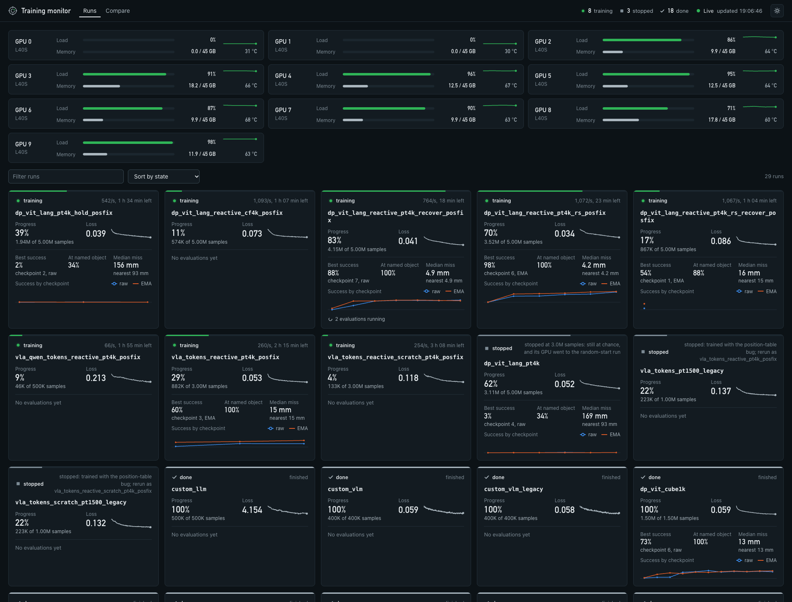
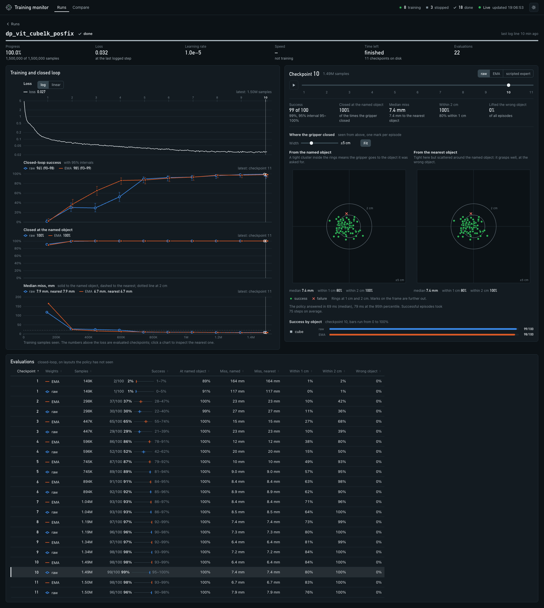
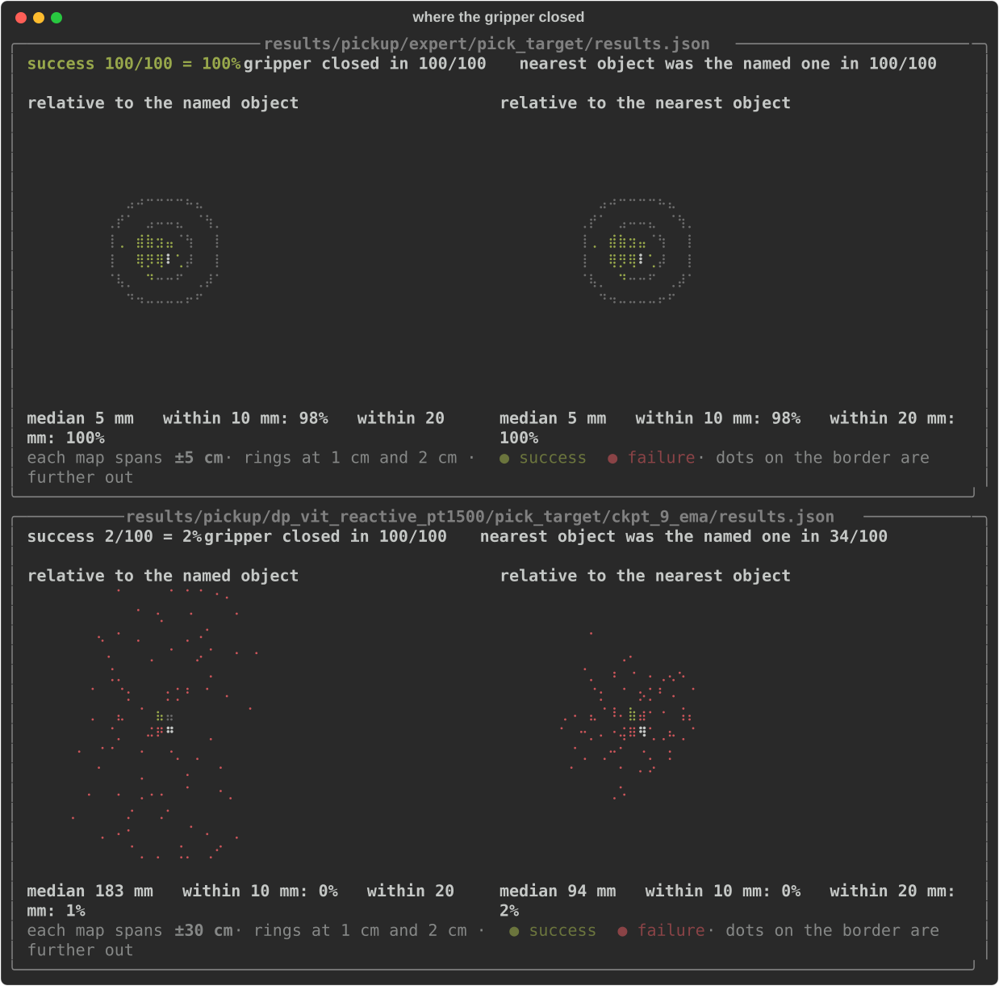

# VLA from scratch

A hands-on guide to the models behind robot manipulation: a language model, a vision-language
model and a vision-language-action policy, each trained from random weights on a single GPU, next
to a pretrained VLA for comparison. Every claim is backed by a run in this repo, including the runs
that failed.

> **Status: work in progress.** The simulator, the training and evaluation scripts, the experiments
> and the field notes are here. The [chapters](tutorial/README.md) are drafts. See the
> [roadmap](tutorial/roadmap.md).

## Why this exists

Most write-ups of robot learning show the run that worked. Getting there is the hard part: a policy
can reach a low training loss, reproduce recorded actions almost exactly, and still succeed 0% of
the time, and nothing in the logs says why. This repo records the route, with the measurements that
separate one cause from another.

## What you get

**A live monitor that shows what the loss hides.** Every run with its progress, loss and speed,
next to the closed-loop success of each of its checkpoints, how often the gripper closed at the
object the instruction named, and how far it missed; GPU load on top. It is a small web server on
the training machine (Python standard library only, nothing to build) and updates as the runs train.



```bash
.venv/bin/python -m sim.pickup.monitor_server                        # on the training machine
sim/pickup/scripts/monitor_remote.sh <ssh-host> <repo-directory>     # or from your own computer: starts it over ssh, opens the browser
```

Each run has a page: the loss, the success of every checkpoint with its interval (trained and
averaged weights), where the gripper closed in each of the 100 evaluation episodes, and the table
behind the charts. Drag the checkpoint slider and watch the cloud of grasp attempts tighten.



The same table is available in a terminal (`.venv/bin/python -m sim.pickup.monitor`), and runs can
be laid over each other on the monitor's Compare page.

**A picture of how a policy fails.** Each dot is where the gripper closed in one evaluation
episode, relative to the object. The scripted expert (top) lands inside the 1 cm ring every time.
The policy below it scores 2%, and the map shows why: it is not narrowly missing, it closes
anywhere within 30 cm of the object it was asked for.



```bash
.venv/bin/python -m sim.pickup.grasp_map results/pickup/<run>/<task>/results.json
```

**One command per step**, from demonstrations to a closed-loop number, with runs that restart
themselves when they die and checkpoints that are evaluated while training continues:

```bash
uv sync --group preprocessing --group sim && sim/pickup/scripts/fetch_assets.sh
sim/pickup/scripts/make_dataset.sh pick_target 4000 pick_target_4k --random_start --disturb_prob 0.5
sim/pickup/scripts/train_resilient.sh dp_vit_lang_reactive pick_target_4k my_run 5000000
sim/pickup/scripts/eval_checkpoints.sh experiments/pickup/my_run pick_target
```

That is the recipe that reached 94% here (about an hour and a half on one 46 GB GPU) and that still
succeeds about nine times in ten when the object is moved while the robot reaches for it, or as its
gripper closes. Without the two options on the first line the same policy reaches 93% and fails
every one of those tests, and at a fifth of the budget either one looks broken. The table below
says why.

**Tests that a success rate cannot give you.** Move the object while the robot is reaching for it,
hand the policy over after the expert has started toward the wrong object, freeze the cameras on
their first frame: each is one flag of the evaluation, and each told us something the success rate
did not.

```bash
sim/pickup/scripts/eval.sh experiments/pickup/my_run pick_target 100 --disturb reach
sim/pickup/scripts/eval.sh experiments/pickup/my_run pick_target 100 --stale_images
```

## What is here today

| | |
|---|---|
| [sim/pickup](sim/pickup/README.md) | MuJoCo tabletop pick-up task (Franka Panda), scripted expert, data collection, training and closed-loop evaluation |
| [tutorial/chapters](tutorial/README.md) | The tutorial, 37 chapters in draft: language models, vision, VLMs, actions, VLAs, data, training, evaluation, two case studies |
| [tutorial/notes.md](tutorial/notes.md) | Field notes: what worked, what didn't, and how each was measured |
| [tutorial/lab-notebook.md](tutorial/lab-notebook.md) | Every number measured here, by run and checkpoint |
| [tutorial/roadmap.md](tutorial/roadmap.md) | The experiments queued, the chapter outline, and the list of framework fixes |

## Findings so far

Closed-loop success on layouts the policy never saw.

| Finding | Evidence |
|---|---|
| Check the task with a scripted expert first | Expert: 99-100/100 on the task where every first-round policy scored 0-6% |
| Training loss and open-loop error do not predict success | A 74% policy and a 1% policy reproduce recorded expert actions equally well; the lowest loss here belongs to a 0% policy |
| Measure how a policy fails | Where the failing policies closed the gripper did not depend on where the objects were (slope under 0.1, R² under 0.01, where a policy that goes to the object has 1): they were not imprecise, they were not looking |
| One pooled vector is not enough for grasping | Pooled image embedding 4%, image patch tokens 30%, same data |
| Looking at the scene arrives late and all at once | Same policy, same 4000 demonstrations: 0% after 1.0M training samples, 36% after 2.0M, 70% after 2.5M, 85% after 5M. With 1500 demonstrations: 0-3% up to 1.2M, 64% at 3M. A budget that ends too early reads as a broken design |
| The previous action as an input lets the policy stop looking | With history 2% after 3M samples, without it 75-81%. The history policy is not blind: told the expert's first action it finds the named object 97% of the time |
| A policy that succeeds may look only once | The 85% policy, shown only its first camera frame for the whole episode, still reaches the named object in 99% of episodes. Move the object 8 cm mid-reach and it closes where the object was: 0/96 |
| A policy looks where its demonstrations make looking necessary | Same policy, same 4000 episodes, different content: clean passes from one start pose 93%; random start poses 98%, and 97% from poses where the first scores 9% |
| Self-correction has to be in the data | Trained on demonstrations in which the object is moved and the expert recovers, the policy follows a moved object (79-88%) and retries a missed grasp (78 of 99). With random start poses in the same demonstrations it does so at 89-94%, from any start pose, and keeps 94% on the unchanged task. Every policy trained on clean demonstrations: 0-18% |
| Averaged weights lead during the transition | 36% against 4% at 2.0M samples; equal before and after |
| Two sampling steps are usually enough | 1 flow step 61%, 2 steps 89-90%, 10 steps 83-85%; on seven later policies 2 steps came within a point of 10 on four and cost 12-19 points on the three trained with repeated early windows or every object named |
| Know the tolerance of the task | Cube and T block forgive a 2 cm offset. At 1 cm the round objects lose 40% on one simulator build and under 6% on another: measure it where you evaluate |
| Train/inference mismatches hide in preprocessing | Five so far, none raised an error: a pixel-range bug (captioning 0% -> 85%), a position table computed in half precision (641 distinct positions out of 2048; fixing it took one pair of runs from 83% to 93% and a second pair from 90% to 96%), a previous-action slot that holds the answer in training and nothing when served, and two more |
| A pretrained backbone buys mainly an earlier start | VLA with every token of its backbone: pretrained on captions it starts to look after 0.25M samples, from random weights after about 1.0M; they end close, at 86% / 87% and 75% / 85% (trained weights 11 points apart, averaged weights 2). Qwen with every token: 70% / 72% after 0.5M samples, against 5% with one vector |

Details and the open questions are in the [field notes](tutorial/notes.md).

## Website

The chapters and their animated explanations are being built as a site in a separate repository:
[vla-from-scratch-site](https://github.com/arianizadi/vla-from-scratch-site).

## Getting started

The pick-up sim has its own [README](sim/pickup/README.md) with the commands to collect
demonstrations, train a policy and evaluate it closed-loop.

## Built on VLA Foundry

The training framework is [VLA Foundry](https://github.com/TRI-ML/vla_foundry) from Toyota Research
Institute, used under the MIT licence (see [LICENSE](LICENSE)). This repository started as a fork of
it. The framework's own documentation is kept in [FOUNDRY.md](FOUNDRY.md), and the fixes made to it
here are listed in the [roadmap](tutorial/roadmap.md#framework-fixes-ledger).
