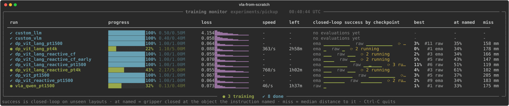

# VLA from scratch

A hands-on guide to the models behind robot manipulation: a language model, a vision-language
model and a vision-language-action policy, each trained from random weights on a single GPU, next
to a pretrained VLA for comparison. Every claim is backed by a run in this repo, including the runs
that failed.

> **Status: work in progress.** The simulator, the training and evaluation scripts, the first
> experiments and the field notes are here. The chapters are being written. See the
> [roadmap](tutorial/roadmap.md).

## Why this exists

Most write-ups of robot learning show the run that worked. Getting there is the hard part: a policy
can reach a low training loss, reproduce recorded actions almost exactly, and still succeed 0% of
the time, and nothing in the logs says why. This repo records the route, with the measurements that
separate one cause from another.

## What you get

**A dashboard that shows what the loss hides.** Every run with its progress, loss and speed, next
to the closed-loop success of each of its checkpoints, how often the gripper closed at the object
the instruction named, and how far it missed.



```bash
.venv/bin/python -m sim.pickup.monitor
```

**A picture of how a policy fails.** Each dot is where the gripper closed in one evaluation
episode, relative to the object. The scripted expert (top) lands inside the 1 cm ring every time.
The policy below it scores 2%, and the map shows why: it is not narrowly missing, it closes
anywhere within 30 cm of the object it was asked for.


```bash
.venv/bin/python -m sim.pickup.grasp_map results/pickup/<run>/<task>/results.json
```

**One command per step**, from demonstrations to a closed-loop number, with runs that restart
themselves when they die and checkpoints that are evaluated while training continues:

```bash
uv sync --group preprocessing --group sim && sim/pickup/scripts/fetch_assets.sh
sim/pickup/scripts/make_dataset.sh pick_target 1500 pick_target_1500
sim/pickup/scripts/train_resilient.sh dp_vit_lang pick_target_1500 my_run 1000000
sim/pickup/scripts/eval_checkpoints.sh experiments/pickup/my_run pick_target
```

## What is here today

| | |
|---|---|
| [sim/pickup](sim/pickup/README.md) | MuJoCo tabletop pick-up task (Franka Panda), scripted expert, data collection, training and closed-loop evaluation |
| [sim/pickup/RESULTS.md](sim/pickup/RESULTS.md) | Every result so far, with confidence intervals |
| [tutorial/notes.md](tutorial/notes.md) | Field notes: what worked, what didn't, and how each was measured |
| [tutorial/roadmap.md](tutorial/roadmap.md) | The experiments queued, the chapter outline, and the list of framework fixes |

## Findings so far

Closed-loop success on layouts the policy never saw.

| Finding | Evidence |
|---|---|
| Check the task with a scripted expert first | Expert: 99/100 on the task where every learned policy scored 0-6% |
| Training loss and open-loop error do not predict success | A 74% policy and a 1% policy reproduce recorded expert actions equally well; the lowest loss here belongs to a 0% policy |
| Measure how a policy fails | Three policies ran the full grasp motion about 10 cm from any object and reached the named object at chance (29-33% with three objects) |
| One pooled vector is not enough for grasping | Pooled image embedding 4%, image patch tokens 30%, same data |
| A failing policy ignores the scene; it does not average | Where the failing policies closed the gripper was unrelated to where the objects were (slope 0.03, R² under 0.02): a random point on the table, about 10 cm from the nearest of three objects |
| Know the tolerance of the task | Cube and T block forgive 2 cm; can and hex nut fall to about 60% at 1 cm |
| Train/inference mismatches hide in preprocessing | With a pixel-range bug a VLM scored 0% on a captioning check; with it fixed, 85%. Nothing raised an error |

Details and the open questions are in the [field notes](tutorial/notes.md).

## Website

The chapters and their animated explanations are being built as a site in a separate repository:
[vla-from-scratch-site](https://github.com/arianizadi/vla-from-scratch-site).

## Getting started

The pick-up sim has its own [README](sim/pickup/README.md) with the commands to collect
demonstrations, train a policy and evaluate it closed-loop.

## Built on VLA Foundry

The training framework is [VLA Foundry](https://github.com/TRI-ML/vla_foundry) from Toyota Research
Institute, used under the MIT licence (see [LICENSE](LICENSE)). This repository started as a fork of
it. The framework's own documentation is kept in [FOUNDRY.md](FOUNDRY.md), and the fixes made to it
here are listed in the [roadmap](tutorial/roadmap.md#framework-fixes-ledger).
