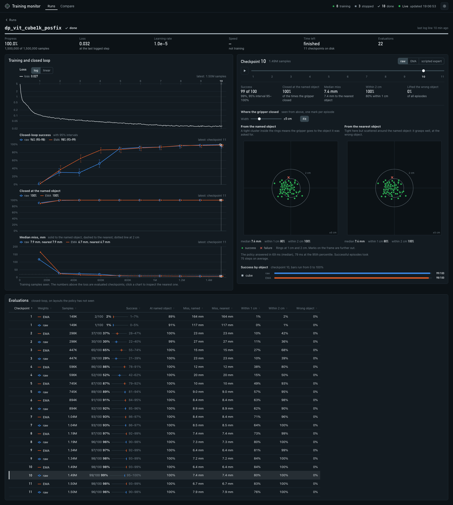

# Pickup sim: a MuJoCo training and evaluation environment for robot policies

A self-contained loop for training policies on a simulated robot and measuring them closed-loop:

```
scripted expert in MuJoCo ──> LeRobot v2.0 dataset ──> Foundry shards ──> vla_foundry/main.py
                                                                               │
        closed-loop success rate <── simulator client <── socket ── policy server (checkpoint)
```

- **Robot**: Franka Panda (MuJoCo Menagerie) on a table, 20 Hz control.
- **Objects**: red cube, green can, blue hex nut, yellow T block, modelled in Blender
  (`assets/build_assets_blender.py`, `assets/pickup_assets.blend`) and exported as OBJ. Physics uses
  primitive collision shapes; the Blender meshes are the visuals.
- **Observations**: `front` and `wrist` RGB cameras (224x224) and an 8-D state
  (7 joint angles + gripper opening in [0, 1]).
- **Actions**: 8-D absolute targets (7 joint positions + gripper command, 1 = open, 0 = closed).
  `action[t]` is the command applied after observing frame `t`.

| Task | Scene | Instruction | Success |
|---|---|---|---|
| `pick_cube` | one cube, random pose | "pick up the red cube" | cube held 8 cm above the table for 0.5 s |
| `pick_target` | 3 of the 4 objects, random poses | "pick up the \<object\>" | the *named* object held 8 cm up for 0.5 s |

Episodes time out after 200 steps (10 s). Demonstrations use seeds `0..`; evaluation uses seeds
`1_000_000..`, so every evaluated layout is unseen.

## Layout

```
sim/pickup/
  env.py             PickupEnv: scene construction (MjSpec), reset/step, cameras, success test
  expert.py          scripted top-down grasp expert (Cartesian plan + damped-least-squares IK)
  collect.py         run the expert, write a LeRobot v2.0 dataset (inline JPEG parquet)
  policy_server.py   serve action chunks from a checkpoint over a local socket
  eval.py            closed-loop evaluation client; also runs the scripted expert (--expert)
  diagnostics.py     where the gripper was, relative to the objects, when it first closed
  disturb.py         move the named object during an episode (robustness tests, recovery demonstrations)
  grasp_tolerance.py grasp success against a controlled placement error, per object
  open_loop_check.py compare predicted chunks with expert actions on recorded samples
  caption_data.py    captioned scene renders for vision-language pretraining
  vlm_check.py       held-out captioning check for a trained VLM
  monitor.py         terminal dashboard: runs, loss, closed-loop success per checkpoint, GPUs
  monitor_server.py  graphical monitor: a web server for the same view in a browser
  monitor_ui/        the pages that server sends (plain HTML, CSS and JavaScript, no build step)
  runstate.py        what both monitors show, read from the training logs and the results
  summarize.py       all closed-loop results as one table (or JSON)
  export.py          runs, evaluations, probes and rollout traces as JSON, for plots or a results page
  boost_early_windows.py  repeat the windows from the first frames of each demonstration in a dataset
  text_data.py       web text for the language-model stage of the from-scratch path
  smoke_test.py      expert-only sanity check
  configs/           preprocessing + training configs
  scripts/           fetch_assets.sh, make_dataset.sh, train.sh, train_resilient.sh (auto-resume), eval.sh,
                     eval_checkpoints.sh (every checkpoint), custom_path.sh (LLM -> VLM -> VLA stages),
                     monitor_remote.sh (the graphical monitor from your own computer, over ssh)
  assets/            Blender source, exported meshes; third_party/ (Panda model, fetched, not committed)
```

## Setup

One environment runs everything (simulator, preprocessing, training, policy server):

```bash
uv sync --group preprocessing --group sim
sim/pickup/scripts/fetch_assets.sh          # once: Panda model from MuJoCo Menagerie
```

Rendering is headless through EGL (`MUJOCO_GL=egl`, set by the scripts), so no display is needed.

The scripts read a few environment variables, documented in `scripts/_common.sh`:

| Variable | Use |
|---|---|
| `PICKUP_GPU` | GPU index (as `nvidia-smi` shows it) for compute and rendering. Lets several jobs run side by side on a multi-GPU machine |
| `PICKUP_WORKERS` | simulator processes and preprocessing CPUs for `make_dataset.sh` (default 8) |
| `PICKUP_CPU_THREADS` | CPU threads per process (default 4). Without a cap, numerical libraries start one thread per core, which saturates a many-core machine |
| `PICKUP_FOUNDRY_PYTHON`, `PICKUP_SIM_PYTHON`, `PICKUP_ROOT` | run the training side or the simulator side with a different interpreter, for example inside a container |

## Quickstart

All commands run from the repository root.

```bash
# 1. demonstrations -> shards   (4000 episodes of the three-object task)
sim/pickup/scripts/make_dataset.sh pick_target 4000 pick_target_4k

# 2. train                      (config, dataset, run name, total training samples)
sim/pickup/scripts/train_resilient.sh dp_vit_lang_reactive pick_target_4k my_run 5000000

# 3. closed-loop evaluation     (experiment dir, task, episodes)
sim/pickup/scripts/eval.sh experiments/pickup/my_run pick_target 100
```

This is the recipe that reached 85% on `pick_target` (about an hour and a half of training on one
46 GB GPU). For a first run that finishes sooner, use the single-object task: `pick_cube` with 1000
demonstrations and 1.5M samples reached 91-97% with the same config. Evaluate checkpoints while the
run trains (next section): the same policy scores 0% for the first million samples.

`train_resilient.sh` takes the same arguments as `train.sh` and restarts the run from its newest
checkpoint if it dies or stops making progress. Use it for anything longer than a few minutes. It
keeps one trainer per run name: a second copy started with the name of a run that is still training
exits instead of writing into the same directory.

`eval.sh` writes `results/pickup/<run>/<task>/results.json` and a few rollout videos. The results
hold the success rate with a Wilson 95% interval, a per-object breakdown, and grasp diagnostics:
whether the gripper closed, which object it was nearest to when it did, and how far it missed by.
Useful knobs: `--exec_horizon` (actions executed per predicted chunk, default 8), `--flow_steps`
(denoising steps, default 10), `--seed_start`, `--videos`. `PICKUP_WEIGHTS=raw|ema` picks the
trained or the averaged weights of a run that saved both (the configs here do).

### Watching runs

`eval_checkpoints.sh` evaluates every checkpoint of a run (newest first, several at a time with
`PICKUP_EVAL_JOBS`), and with `PICKUP_WATCH=1` it follows a run that is still training. Started
next to `train_resilient.sh`, it turns a run into a curve of closed-loop success against training:

```bash
sim/pickup/scripts/train_resilient.sh dp_vit_lang_reactive pick_target_4k my_run 5000000 &
PICKUP_WATCH=1 PICKUP_EVAL_JOBS=2 sim/pickup/scripts/eval_checkpoints.sh experiments/pickup/my_run pick_target 100 &
```

`monitor.py` is a terminal dashboard over all runs. It shows progress, the loss with its history,
throughput, time left and restarts, and next to them what the loss does not tell you: the
closed-loop success of each checkpoint, how often the gripper closed at the named object, and the
median miss. GPU load is underneath. It only reads logs and results, so it can be opened and closed
at any time, in another terminal or over ssh.

```bash
.venv/bin/python -m sim.pickup.monitor                         # live, Ctrl-C quits
.venv/bin/python -m sim.pickup.monitor --once --svg runs.svg   # one frame, saved as an image
.venv/bin/python -m sim.pickup.summarize --task pick_target    # the same results as one table
```

`monitor_server.py` is the graphical monitor: the same runs in a browser, with charts of the loss,
of closed-loop success per checkpoint, of how the policy fails, and of GPU load. It is a small web
server that reads the same logs and results. It needs only the Python standard library, no build
step and no network access. There are two ways to use it.

On the training machine, start the server and open the URL it prints. It listens on that machine
only, so from another computer reach it through an ssh port forward:

```bash
.venv/bin/python -m sim.pickup.monitor_server          # on the training machine, Ctrl-C stops
ssh -L 8765:127.0.0.1:8765 <training-machine>          # on your computer; then open http://localhost:8765
```



From your own computer, one script does both and opens the browser. Ctrl-C ends the ssh session
and, with it, the server on the training machine:

```bash
sim/pickup/scripts/monitor_remote.sh <ssh-host> <repo-directory-on-that-host> [port]
```

To serve the monitor on the network instead, pass `--host 0.0.0.0`. On any address other than
loopback the server requires a token: it prints a URL that ends in `?token=...` (choose the token
with `--token`) and answers 401 without it. On loopback no token is asked for, which leaves the port
open to the other users of that machine; pass `--token` to require one there too.

### Probing a policy

A success rate does not say what a policy depends on. `eval.py` (and `eval.sh`, which passes extra
arguments through) can change one thing about the episode and measure again:

| Option | The question it answers |
|---|---|
| `--stale_images` | Keep sending the first frame's images: does the policy need the cameras after its first look? |
| `--expert_prefix K` | The scripted expert drives the first K steps, then the policy takes over. With `--prefix_target distractor` the expert heads for another object of the layout: does the policy follow the instruction, or the motion it finds itself in? |
| `--first_prev_action expert` | For policies that are given their previous action: send the expert's first command with the first query instead of the hold command the robot is really under. A large gain means the policy reads its goal from that input |
| `--disturb reach` | Move the named object once while the gripper is on its way (`--disturb_step`, default 15; `--disturb_mm`, default 80): does the policy follow it? |
| `--disturb grasp` | Move it at the moment the gripper first closes: does the policy try again? The results count grasp attempts (`retried_rate`) |
| `--random_start` | Start every episode from a random gripper pose above the table instead of the home pose |
| `--noise episode` | Start every chunk of an episode from the same noise |
| `--exec_horizon`, `--flow_steps` | Actions executed per predicted chunk; sampling steps |
| `--traces N` | Save the first N rollouts as JSON (joint angles, gripper and object poses per control step) for replays and plots |

`--expert --expert_reactive` runs the scripted expert that plans again when the object has moved or
its fingers closed on nothing: the reference for the two disturbances. The results file records the
settings of every evaluation, and for disturbances how the episodes with a moved object went.

```bash
sim/pickup/scripts/eval.sh experiments/pickup/my_run pick_target 100 --disturb reach --disturb_step 20
PICKUP_OUT=results/pickup/my_run/pick_target/frozen sim/pickup/scripts/eval.sh experiments/pickup/my_run pick_target 100 --stale_images
```

Set `PICKUP_OUT` to keep each probe in its own directory; `summarize.py` and `export.py` list them
next to the checkpoint evaluations.

### What the demonstrations contain

`make_dataset.sh <task> <episodes> <name> [collect.py options]` passes its extra arguments to
`collect.py`. By default every demonstration is one clean pass from the home pose, one instruction
per layout. A policy trained on that looks at the scene once and then follows its own arm (see the
field notes). The options change what the data can teach:

| Option | What it adds |
|---|---|
| `--targets_per_layout 3` | Every layout is demonstrated once per object, so the same scene appears with different instructions |
| `--disturb_prob 0.5` | In that share of the episodes the named object is moved once, during the reach or as the gripper closes, and the expert plans again or retries: demonstrations of recovery |
| `--random_start` | Every episode starts from a random gripper pose above the table, so the arm's own position no longer gives the goal away |
| `--hold_steps 1` | Every episode begins with a frame of the robot at rest, for policies that are given their previous action (the first training window then holds what serving will provide) |

`boost_early_windows.py` builds a copy of a preprocessed dataset in which the windows that start in
the first frames of each demonstration, the ones that need the instruction, appear several times:

```bash
.venv/bin/python -m sim.pickup.boost_early_windows --shards data/preprocessed/pick_target_4k/shards \
    --out data/preprocessed/pick_target_4k_early/shards --max_frame 7 --repeat 5
```

### Results as data

```bash
.venv/bin/python -m sim.pickup.summarize --task pick_target      # one table: success, slope, miss per checkpoint
.venv/bin/python -m sim.pickup.export --out export/              # JSON: runs, evaluations, probes, per-episode files, traces
```

### Checks that need no trained policy

Three checks that do not need a trained policy, or do not need the simulator:

```bash
# the scripted expert through the same evaluation loop: is the task itself sound?
.venv/bin/python -m sim.pickup.eval --task pick_target --episodes 100 --expert --out results/pickup/expert/pick_target

# how much placement error does a grasp tolerate, per object?
.venv/bin/python -m sim.pickup.grasp_tolerance --out results/pickup/grasp_tolerance.json

# does a checkpoint reproduce recorded expert actions? (no simulator involved)
.venv/bin/python -m sim.pickup.open_loop_check \
    --checkpoint_dir experiments/pickup/<run> --shards data/preprocessed/<dataset>/shards
```

## How it plugs into Foundry

- `collect.py` writes exactly the LeRobot v2.0 layout Foundry's `--type lerobot` converter reads.
  Images are stored inline as JPEG, so the simulator renders at the training resolution and
  `configs/preprocess.yaml` sets `resize_images_size: null` (the converter cannot resize images
  that are already encoded).
- Samples are 16-step windows: 1 past + current + 14 future, with images at `t-1` and `t`.
  Foundry treats the first slot as a known past action and predicts the remaining 15.
- `policy_server.py` builds its model input with the same `RoboticsProcessor.process_inputs` and
  `add_action_and_proprioception_fields` calls as the training dataloader, then denormalizes the
  predicted chunk with the run's saved normalizer. It reads everything from the experiment
  directory (`config.yaml`, `config_processor.yaml`, `stats.json`, latest checkpoint or EMA).
- Data-loader workers hand batches to the trainer through shared memory (`/dev/shm`). With the
  passthrough processor a batch of 64 is ~150 MB. If shared memory is small (containers often get
  64 MB to 2 GB), too many workers or too much prefetch overflows it and the run dies without a
  traceback; lower `data.num_workers` and `data.prefetch_factor`.

## Results

Every number measured with this environment is in the [lab notebook](../../tutorial/lab-notebook.md);
what the numbers mean is in the [field notes](../../tutorial/notes.md). `RESULTS.md` holds the first
round only.
