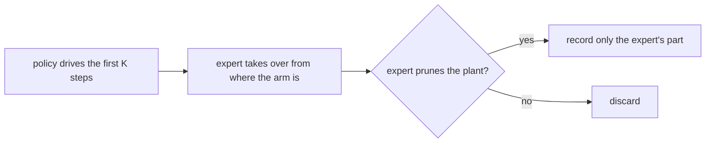

# Pruning a Plant

Steps 6-8 of the roadmap's Phase 4 are the pruning tasks themselves: a potted plant on a turntable,
side shoots to cut off, a flower to leave alone. This chapter follows them in order: what each step
adds, what the policy learned, how its turning was checked, what a longer training budget changed,
and why demonstrations in which the expert takes over from the policy first made things worse.

## The idea

**The scene.** A potted plant stands on a motorised stand. It has a main stem with a flower on top
and one to three **side shoots**, small branches leaving the main stem. The stand turns while one of
its two push buttons is held down, one button for each direction. The robot must cut every side
shoot off the main stem and leave the main stem and its flower whole.

**A cut.** Holding a shoot between the shut jaws, 2-5 cm out from the main stem, for 3 control steps
cuts it there; the outer part falls.

**Damage.** Touching the flower, pushing the main stem with more than 5 N, or cutting the main stem
damages the plant and ends the episode as a failure.

**The ladder.** The full task was not trained at once. Each step adds one property to the one
before:

| Step | Task | What is added |
|---|---|---|
| 6 | `prune_one` | one side shoot, already facing the robot |
| 7 | `prune_turn` | one side shoot at any angle: turn the plant first when it faces away |
| 8 | `prune` | two or three shoots: turn, cut, turn, cut |

Each step asks the roadmap's three questions: can the scripted expert do it, does the policy learn
it from the expert's demonstrations, and what must the demonstrations contain.

## How it went

### Step 6: one shoot, facing the robot

The scripted expert prunes 100/100 with no damage. A policy (`dp_vit_lang_reactive`, the recipe of
[Which demonstrations teach](72-which-demonstrations-teach.md)) trained on 4000 demonstrations with
random start poses and the jaws held shut 10 frames past the cut, for 5M samples:

| Seed | Pruned (trained / averaged) | Flower damaged (trained / averaged) |
|---|---|---|
| 42 | 80/100 / 77/100 | 12 / 9 |
| 43 | 89/100 / 84/100 | 6 / 6 |

Early in training the policy damages the flower in most episodes (up to 76% at the first
checkpoint of seed 42); damage falls as success rises, and what is left is mostly a touch of the
flower head. A successful episode takes about 120 control steps (6 s).

The jaws held shut past the cut are the lesson of step 5 ([Toward real tasks](110-toward-real-tasks.md)):
a cut ends a demonstration 3 steps after the jaws reach the stem, so without that **tail** of extra
frames the demonstrations hardly ever show a shut gripper waiting, and the policy opened again before
its fingers arrived.

### Step 7: turn the plant first

One shoot at a random angle. When it points more than 25° away from the robot, the plant has to be
turned first by holding the button that turns it the right way. The expert succeeds in 100/100 (211
control steps on average). The same 4000-demonstration recipe, 10M samples:

| Who | Pruned (trained / averaged) | Flower damaged (averaged) | Steps (success) | Degrees turned / needed | First press the short way |
|---|---|---|---|---|---|
| expert | 100/100 | 0 | 211 | 89 / 91 | 100% |
| seed 42 | 85/100 / 90/100 | 3 | 232 | 106 / 88 | 88% |
| seed 43 | 81/100 / 83/100 | 10 | 226 | 95 / 85 | 87% |

**Is the turning on purpose?** A policy could succeed by pressing a button at random and cutting
whatever comes round. To tell the two apart, a checkpoint of seed 42 (83/100) was rolled out on 60
other layouts with every button press recorded:

- When the shoot was out of reach, it pressed a button in 43 of 46 episodes.
- When the shoot already faced the robot (within about 10°), it did not press.
- It never switched buttons in an episode.
- At the cut the shoot pointed a median of 3° (at most 13°) from the robot.
- The first press went the short way in 34 of 43 (79%). The misses were mostly shoots that had to
  turn counter-clockwise (14 of 20 the short way, against 20 of 23 clockwise): the policy leaned
  toward one button. Going the long way still worked; it held the button until the shoot came round.

By the final checkpoint the short way is taken in 87-88%, and the policies take about 10% longer
than the expert and turn 10-20% further.

### Step 8: the whole plant

Two or three shoots at random angles. The expert prunes 100/100 in about 515 control steps; an
episode may last 1000.

**10M samples are not enough.** From 2000 demonstrations, two seeds end at 34 and 22 out of 100
(averaged weights, final checkpoint). At checkpoint 5 the failures are mostly timeouts (74 and 82
of 100), not damage (17 and 8). Rolled out on 20 layouts with every cut and press recorded, the
policy cut at least one shoot in 13 and two or more in 7. The first cut came 200-700 steps in and
the next 300-450 steps later; in the last 200 steps of the episodes that ran out of time the gripper
was mostly near neither an uncut shoot nor a button, and some turned the plant 450-560° in all. The
same checkpoint with twice the time (2000 steps) prunes 27 and 30 plants instead of 9 and 10, but
36 and 52 still run out of time and the flower is damaged in more (37 and 18). It is slow and it
wanders, and more time also means more chances to touch the flower.

**A longer plan learns faster per sample.** The run planned for 20M samples (same demonstrations and
seed) prunes 29/100 at its second checkpoint, about 3.6M samples in, where the 10M runs were at 2-6.
The cause is the learning-rate schedule. The learning rate follows a cosine over the *planned*
budget (`lr_scheduler: cosine`, peak 5e-4):

$$\eta(s) = \eta_{\text{peak}} \cdot \tfrac12\left(1 + \cos\frac{\pi s}{S}\right)$$

where $s$ is the samples seen so far and $S$ the planned total. The same number of samples is an
earlier point of a longer plan, where the rate is still high. Step 5 measured the effect first: at
3.6M samples a 10M plan still had about 71% of its peak rate, a 5M plan about 18%. The 20M run ends
at 81/100 / 79/100 (trained / averaged), the flower touched in 3 and 4, the rest out of time;
successful episodes take about 640 control steps.

**Five 20M runs.** Final checkpoints, trained / averaged weights:

| Demonstrations | Seed | Final (trained / averaged) | Flower damaged (final) |
|---|---|---|---|
| 2000 | 42 | 81/100 / 79/100 | 4 |
| 2000 | 43 | 44/100 / 56/100 | 2 |
| 2000 | 44 | 80/100 / 78/100 | 7 |
| 4000 | 42 | 78/100 / 65/100 | 2 |
| 4000 | 43 | 76/100 / 76/100 | 6 |

Twice the demonstrations do not help at this budget: the 4000-demonstration runs (65-78) sit inside
the range of the 2000-demonstration runs (56-81). The seed matters more: seed 43 of the
2000-demonstration runs learns late and never catches up. Between neighbouring checkpoints a run
moves by up to 13, so the best of eleven checkpoints is an optimistic number; the final checkpoints
are the fair comparison. Twice the budget again (40M samples) ends at 75/100 / 80/100 with
successful episodes of about 650 steps: past 20M samples a longer plan does not help, and the policy
is no faster.

### Takeover demonstrations

Most failures are the policy wandering into states the demonstrations never show. The standard
remedy is **DAgger** (Ross et al., below): let the learner drive, ask the expert what it should have
done in the states the learner reached, and train on those answers too. Here the expert is a script
that can plan from any pose, so it can take over the arm:



K is drawn uniformly from 0-700 control steps per episode.

**First attempt: worse.** Of 2581 attempts, 369 ended before the handover (the policy pruned the
plant in 313 and damaged it in 56). Of the 2212 handovers the expert succeeded in 2033 (92%) and
touched the flower in 160. The 2000 kept episodes were handed over at a median K of 296. Trained for
20M samples on these plus the 2000 ordinary demonstrations, the three seeds end at 0/100 / 0/100,
27/100 / 23/100 and 19/100 / 28/100 (trained / averaged), against 79, 56 and 78 without them. The
runs rise, then fall as training goes on, timing out more and touching the flower more.

Two faults in the dataset:

1. **No tail.** The takeover half was recorded without the 10 frames of shut jaws after the cut; the
   ordinary half has them.
2. **Moves the ordinary expert never makes.** From some poses the expert first backs the hand out of
   the plant and returns to the lane in front of it. Those moves are 4% of the takeover frames, in
   92% of its episodes. Near a shoot, the two halves of the data label similar states with opposite
   actions: one says "close in", the other "back out".

A policy learns a map from what it sees to what it does. Two teachers who answer the same picture
differently give it no single answer to learn.

**Corrected: no collapse, no gain.** The second takeover dataset has the tail of 10 steps and leaves
out the back-out and lane-return frames: the recording starts once the expert is on its ordinary plan
(1827 of the 2000 kept episodes began with such moves; 32,062 steps were left out, a median of 14 per
episode). Same handover range, other layouts, kept episodes handed over at a median K of 300:

| Seed | Final (trained / averaged) | Flower damaged (final) | Without takeover demonstrations |
|---|---|---|---|
| 42 | 79/100 / 83/100 | 7 | 81/100 / 79/100 |
| 43 | 25/100 / 24/100 | 7 | 44/100 / 56/100 |
| 44 | 73/100 / 68/100 | 16 | 80/100 / 78/100 |

No collapse this time, so the faults of the first dataset caused it; which of the two was not
tested apart. But the takeover demonstrations do not help either: one seed gains a little, the other
two lose more, and the seed that learns late learns later still.

**Where step 8 stands:** about 80/100 on two seeds of three, with most failures out of time and the
flower damaged in 2-7.

## In this repository

The three tasks are entries of `TASKS` in [`sim/pickup/env.py`](../../sim/pickup/env.py):
`prune_one` (one shoot facing the robot, 300 steps), `prune_turn` (one shoot anywhere, 450 steps) and
`prune` (2-3 shoots, 1000 steps). In `PickupEnv`:

- `_drive_turntable` turns the plate at `TURN_SPEED` while exactly one button (`BUTTONS`) is held
  down past `PRESS_TRAVEL`.
- `holds_shoot` tests the jaws on a shoot inside `CUT_ZONE` (0.02-0.05 m out along it);
  `_plant_result` cuts it after `CUT_STEPS` (3) such steps in a row.
- `_check_damage` marks a touch of the flower at once and records the push on the main stem;
  `_plant_result` fails the episode above `STEM_PUSH_LIMIT` (5 N) or when the main stem is held for
  `CUT_STEPS`.

The expert plans the cuts and turns in `ScriptedExpert._plan_prune`
([`sim/pickup/expert.py`](../../sim/pickup/expert.py)); `ScriptedExpert.take_over` plans from the arm
as it is, part way through an episode. In [`sim/pickup/eval.py`](../../sim/pickup/eval.py),
`_turning_summary` reports the degrees turned and needed and how often the first press went the short
way.

Demonstrations with random starts and the tail, then a 20M-sample run, then every checkpoint:

```bash
d=sim/pickup/scripts/make_dataset.sh
$d prune 2000 prune_2k --random_start --tail_steps 10
PICKUP_NUM_CHECKPOINTS=10 sim/pickup/scripts/train_resilient.sh dp_vit_lang_reactive \
    prune_2k my_prune_run 20000000
sim/pickup/scripts/eval_checkpoints.sh experiments/pickup/my_prune_run prune
```

Takeover demonstrations from that run's latest checkpoint, added to the ordinary ones (the script
starts one policy server per simulator worker; `collect.py --policy_ports` does the handover in
`hand_over`, and leaves out the expert's preamble):

```bash
sim/pickup/scripts/make_takeover_dataset.sh experiments/pickup/my_prune_run prune 2000 \
    prune_2k_takeover2k --seed 500000 --takeover_steps 0 700 --tail_steps 10 --include data/lerobot/prune_2k
```

## Where it goes wrong

- **A rate that hides how it failed.** "79/100" says nothing about the 21. Count timeouts and
  damage apart (`damaged` in each episode's result); here they call for different fixes.
- **More time is not a fix for wandering.** Doubling the episode length tripled the pruned plants
  at 10M samples, but the flower was damaged more than twice as often (17 to 37, 8 to 18): every
  extra step near the plant is a chance to touch the flower.
- **Comparing budgets at the same checkpoint number.** Checkpoints of a 10M and a 20M run are not
  the same number of samples apart, and the learning rate at a given sample count differs. Compare
  at equal samples, and read the schedule.
- **One seed as the answer.** Five 20M runs end between 56 and 81. A difference of a few points
  between two single runs is inside that spread.
- **Mixed demonstrations that disagree.** Any second source of demonstrations (another expert, a
  takeover, a human) must label the same state the way the first does, and end the same way (the
  tail). Before training, look for states where the two sources act differently.
- **The best checkpoint as the result.** With eleven checkpoints and moves of up to 13 between
  neighbours, the best one is an optimistic pick. Report the final one.

## Background and further reading

Background, not measured here:

- Ross, Gordon and Bagnell, *A Reduction of Imitation Learning and Structured Prediction to No-Regret
  Online Learning*, 2011 ([arXiv:1011.0686](https://arxiv.org/abs/1011.0686)). DAgger: the learner
  drives, the expert labels the states it reaches, and the datasets are aggregated.
- Kelly et al., *HG-DAgger: Interactive Imitation Learning with Human Experts*, 2019
  ([arXiv:1810.02890](https://arxiv.org/abs/1810.02890)). The expert takes control only when the
  learner goes wrong, and only those takeovers are recorded: the form used here.
- Loshchilov and Hutter, *SGDR: Stochastic Gradient Descent with Warm Restarts*, 2017
  ([arXiv:1608.03983](https://arxiv.org/abs/1608.03983)). The cosine learning-rate schedule.

## Check yourself

1. With the cosine above, what share of the peak rate does a 20M plan still have at 3.6M samples?
   Compare it with the 71% of a 10M plan.
2. Rerun `eval.py` on a `prune_turn` checkpoint and read `first_press_short_way` and
   `pressed_when_out_of_reach` in its summary. Do they match the probe above?
3. In a takeover dataset, which frames would you expect a policy to find contradictory, and how
   would you find them before training?
4. Why is a timeout a better failure than a touch of the flower for the next experiment to start
   from?
