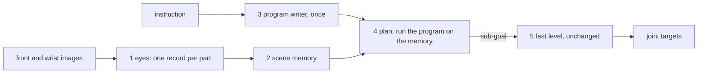

# Reasoning Before Acting

The pruning policies of [Pruning a Plant](111-pruning-a-plant.md) read an instruction that names a
shoot ("the lowest") and learn a lookup from that word to a height on the stem. This chapter is about
instructions where the shoot to cut has to be worked out first: from how many shoots the plant has,
the flower's colour, which shoots are already cut, or a label that is out of view. It follows two
designs (roadmap Phase 7). In the first a vision-language model writes a short note and a small
policy acts on it. In the second, trained *eyes*, a scene memory and a program written by a language
model do the working out, and the small policy acts as before.

## The idea

**The plant** is that of step 9 (`prune_named`): two or three side shoots at random angles on a
turntable with two buttons. Cutting a shoot that is not meant ends the episode as a failure, as does
damage.

**Four kinds of instruction** (`sim/pickup/reasoning.py`), each needing one short step of inference:

| Kind | Example | What has to be worked out |
|---|---|---|
| ordinal | "cut the second shoot from the top" | count the shoots, then count down: with three it is the middle one, with two the lowest |
| conditional | "if the flower is red, cut the lowest shoot, otherwise the highest one" | look at the flower and take the branch that holds |
| exclusion | "cut every side shoot except the highest one" | the other shoots, one or two, keeping track of which are done |
| hidden | "read the label in the pot and cut the shoot it names" | turn the plant to read a card in the pot; turning the shoot into reach usually hides the card again, so what it said has to be remembered |

**Why a lookup cannot do it.** The same sentence names different shoots on different plants. Draw
many tasks and ask how often the best mapping from the instruction's words to the shoots to cut is
right, whatever the plant: 42-65% of the time, depending on the kind (lab notebook, "Reasoning in
words"; `reasoning.lookup_ceiling` computes it). A policy that does not look at the flower, count the
shoots or read the card is capped there. "The math" below works one case out by hand.

**Held-out instructions** (new instructions) put a new combination of trained words in a training
sentence frame, a trained combination in a new frame, or both; the hidden kind has new frames only. No
held-out instruction occurs in training.

The scripted expert solves every kind 99/100. While it works, it writes a **note** at each decision
point, in five fields:

| Field | Says | Example |
|---|---|---|
| see | number of shoots, the flower's colour, the card | `3 shoots, purple flower, label hidden, read cyan` |
| ask | the instruction in a fixed form | `the shoot the label names` |
| so | the inference, and which shoots are done | `cyan names the highest` |
| aim | the shoot to bring in front of the robot, and which button turns it the short way | `the highest, faces me` |
| next | the **sub-goal** | `cut the highest shoot` |

The sub-goal comes from a closed set: "cut the lowest / middle / highest shoot", "show the label",
"stop". Each is a task the small policy already knows how to do.

## Stage 1: reason in words

**The design** ([reasoning-vla.md](../reasoning-vla.md)). Two levels. A **reasoner**, the
vision-language model Qwen3-VL-2B fine-tuned on the expert's notes, looks at the camera images and the
instruction and writes a note every chunk of 8 control steps. A **fast level**, the small 49M-parameter
flow-matching policy of the earlier chapters, reads only the note's sub-goal in place of the
instruction and moves the arm. Both were trained on 8000 demonstrations of a mix of the four kinds.

**Results** (lab notebook; final checkpoints):

| Policy | Training instructions | Held out | Wrong shoot (training / held out) |
|---|---|---|---|
| Baseline: the small policy reading the instruction | 21/100 | 13/100 | 17% / 31% |
| Plain Qwen VLA reading the instruction | 23/100 | 23/100 | 36% / 31% |
| **Two levels** (seed-43 fast level) | **133/200** | 66/200 | 7% / 36% |
| The same with the seed-42 fast level | 74/200 | 39/200 | 9% / 30% |
| One model: Qwen writes the note, then its own action head reads it | 14/100 | 13/100 | 4% / 19% |

Per kind, training instructions: ordinal 22 for the baseline against 32/49 for two levels,
conditional 17 against 47/57, exclusion 13 against 19/49, hidden 14 against 35/45.

**The note is memory.** On hidden-label plants where the card is out of view when the robot cuts,
two levels solve 26/33 and the baseline 1/11. A policy that reads only the current images cannot know
what the card said once it has turned away; the note still carries it.

**The text drives the action: the swap test.** A note the actions ignore would be narration. With
each sub-goal swapped for another shoot's, the fast level (seed 42) solves 5/200 and cuts the shoot
the wrong note names in 50% of episodes; the one model with swapped notes solves 0/100 and cuts the
wrong shoot in 77%. The arm follows the text.

*A film of it is in the site's lesson: the stage-1 policy with its notes shown as it writes them; the last episode
turns the plant to read a hidden label, remembers it and cuts. This is the 133/200 policy.*

**Each level alone.** Given the expert's sub-goals, the fast level solves 75/100 (seed 43) and 86/200
(seed 42), so the reasoner costs about 9 points on training instructions, and the fast level's seed
decides most of the gap between the two two-level rows. Training the reasoner 900k samples longer
raises it to 153/200 and 78/200; adding paraphrased instructions gives 129/200 and 87/200.

### What went wrong in stage 1

Two diagnoses, both measured in the lab notebook, section "Architecture v2", and worked out in
[architecture-v2.md](../architecture-v2.md):

- **It could not count.** The reasoner wrote "2 shoots" for 105 of 108 three-shoot plants. The
  information was there: a small head trained on the frozen vision tower's own 49 tokens reads the
  three-shoot count in 91% of frames. The reasoner was never taught to read it, because its only loss
  was on the text of its notes. Given the true scene facts in place of its own `see` field, the same
  reasoner solves 159/200 and 96/200.
- **Fine-tuning hurt its language.** As downloaded, the language model writes a program with the right
  meaning (below) for 100/100 training and 92/100 held-out instructions. With the stage-1 reasoner's
  fine-tuned weights: 71 and 60. Training on the fixed format of the notes taught it the notes and
  cost it some of the wording it knew. Held out, the reasoner restates a held-out instruction
  correctly only 32-36% of the time.

## Stage 2: eyes, a scene memory and a written program

**The design** ([architecture-v2.md](../architecture-v2.md)) splits the slow level into parts, each
trained on what its job needs:



1. **Eyes** (`sim/pickup/eyes.py`): a small vision transformer, every weight trained, that outputs
   one record per part of the plant (whether it exists, its height on the stem, its bearing on the
   turntable, whether it is cut, whether a camera shows it; the flower's colour; the label). The loss
   is on these records, which the simulator provides for free in every state. The eyes read the count
   right in 97-98% of frames over three seeds (98.5-99% with a crop of the plant), after 35-44 minutes
   of training.
2. **Scene memory** (`sim/pickup/scene.py`): code, no weights. It keeps the records across the
   episode with stable identities through rotation, marks a part cut once seen cut, and keeps the
   label's colour once read.
3. **Program writer** (`sim/pickup/program_writer.py`): Qwen3-VL-2B's language model as downloaded,
   not fine-tuned, writes the instruction once per episode as a short typed program: "cut the second
   shoot from the top" becomes `Cut(Rank(2,top))`, the exclusion example
   `Cut(Except(All(),Rank(1,top)))`, the hidden one `Cut(ReadLabel())`, the conditional one
   `If(FlowerIs(red),Cut(Rank(1,bottom)),Cut(Rank(1,top)))`. A **grammar constraint** allows, at every
   step, only the tokens that keep the text a prefix of some valid program. It guarantees the form,
   not the meaning.
4. **Plan** (`program.Plan`, `sim/pickup/slow_level.py`): at every look, code evaluates the program on
   the memory. Not enough is known: hold still and look again, or "show the label". Every shoot meant
   seen cut: `stop`. Otherwise the sub-goal for the uncut target that needs the least turning.
5. **Fast level**: unchanged, the same weights as in stage 1.

With the program evaluated by code, new *combinations* of trained words are right by construction once
the program is. New sentence *frames* stay a test of the writer.

**Results** (lab notebook; 200 layouts per split, the seed-43 fast level throughout; differences under
about 15 are within noise):

| Slow level | Training instructions | Held out |
|---|---|---|
| Stage 1: the reasoner writes notes from pixels | 133/200 | 66/200 |
| Stage 1 reasoner given the true scene facts | 159/200 | 96/200 |
| v2, the simulator's scene, written program | 166/200 | 138/200 |
| v2, the eyes' scene, written program | 160/200 | 135/200 |
| **v2, the eyes' scene, written program, memory options on** | **169/200** | **148/200** |
| v2, the simulator's scene, the task's own program (ceiling of this fast level) | 169/200 | 154/200 |

The **memory options** answer two errors that the closed loop showed and frame accuracy did not: an
inventory that never completes (a shoot the eyes are sure exists but never see: 4-6/200), and a cut
seen that did not happen (the eyes were trained on expert frames, where shut jaws at a shoot always
mean a cut: 3-12/200). Holding an unseen part, revoking a belief after 3 contradicting looks and giving
up after 80 steps take v2 on the eyes from 143 to 162 on validation layouts.

*A film of it is in the site's lesson: v2 with the program it wrote and what its memory holds shown as it works,
including an instruction it never saw in training and a label it reads, turns away from and still
remembers. This is the version before the reset below: 169/200 and 148/200.*

**The fast level is now the limit.** With the eyes, v2 is within noise of the simulator's own scene,
and with a perfect slow level the fast level still times out in 22/200, 5-8 of them with a correct
sub-goal and an arm that never moves. On the weaker fast-level seed v2 solves 99/200 (simulator scene)
against 74 for the stage-1 notes. With the seed-44 fast level v2 on the eyes solves 169/200 and
145/200: the result does not hang on one fast level.

### A reset for the fast level's wrong first move

About 20 episodes in 200 start for a shoot that faces away, jaws set to cut, without turning the plant
first; three in four of those are lost, and the wrong-shoot cuts come from the same error (an arm that
went for a shoot it cannot reach closes on one it can). The **reset** sends the arm back to its start
pose when the jaws are set to cut a shoot more than 45 degrees out of reach and the plate stands, with
a grace of four looks after each cut, so the fast level chooses again.

All of v2 on the eyes, written program, with resets: **180/200 and 165/200 held out** with the seed-43
fast level (169 and 148 without); 175 and 157 with seed 44 (169 and 145). Wrong-shoot cuts fall from
6-8 per run to 0-1. These are single runs of 200, with the thresholds tuned on seed 43's validation
layouts.

### Two tries at a better fast level

- **Told its aim.** A fast level whose sub-goal also says whether the shoot is in reach and which way
  to turn fixes what it was built for: a button pressed in 99% of the starts that need one against
  85-91%, the short way round in 86-93% against 59-70%, no wrong-shoot cut. It loses as many episodes a
  new way: 26-30 in 200 time out after turning the plate past the target and round again, or closing
  the jaws beside the shoot (4-9 for the sub-goal fast level). All of v2: 163/200 and 152/200, level
  with the sub-goal fast level without resets (169 and 148).
- **A one-second memory.** A fast level that also sees a frame from a second earlier, second seed:
  135/200 on validation layouts, 118 and 105 on evaluation layouts (simulator's scene), 141 with
  resets, below the seed-43 sub-goal fast level. A frame from a second earlier does not help a fast
  level that is strong without it.

The headline configuration stays the sub-goal fast level with resets.

## In this repository

| What | Where |
|---|---|
| Kinds, instructions, held-out splits, note format, lookup ceiling | `sim/pickup/reasoning.py` |
| When the expert writes notes | `sim/pickup/notes.py` |
| Stage 1 serving and evaluation, the swap test | `sim/pickup/policy_server.py`, `sim/pickup/eval.py` (`--subgoals swap`, `--notes swap`), `sim/pickup/scripts/eval_two_level.sh` |
| Eyes, their data and training | `sim/pickup/eyes.py`, `sim/pickup/eyes_data.py`, `sim/pickup/train_eyes.py`, `sim/pickup/collect_scene.py` |
| Scene memory | `sim/pickup/scene.py` |
| Program language, grammar acceptor, plan | `sim/pickup/program.py` |
| Program writer | `sim/pickup/program_writer.py` |
| v2 in the loop, the reset | `sim/pickup/slow_level.py`, `sim/pickup/eval.py --slow_level v2`, `sim/pickup/scripts/eval_v2.sh` |

Stage 1: collect, train both levels, evaluate them together:

```bash
sim/pickup/scripts/make_dataset.sh reason_mix 8000 reason_mix_8k --random_start --tail_steps 10
sim/pickup/scripts/train.sh qwen_reasoner reason_mix_8k qwen_reasoner_mix8k 1000000
sim/pickup/scripts/train.sh dp_vit_lang_reactive_subgoal reason_mix_8k fast_mix8k 20000000
sim/pickup/scripts/eval_two_level.sh experiments/pickup/fast_mix8k experiments/pickup/qwen_reasoner_mix8k reason_mix 100
```

Stage 2: record scene frames, train the eyes, check the writer, run all of v2 (the memory options and
up to two resets an episode are on by default with the eyes):

```bash
python -m sim.pickup.collect_scene --task reason_mix --episodes 6000 --crop --out data/scene/scene_reason_mix_6k
python -m sim.pickup.train_eyes --data data/scene/scene_reason_mix_6k --val data/scene/scene_val_reason_mix \
    --cameras front wrist plant --out experiments/pickup/eyes_vit_fwp_2m --samples 2000000
python -m sim.pickup.program_writer --model Qwen/Qwen3-VL-2B-Thinking --out writer.json
PICKUP_SCENE=eyes PICKUP_EYES=experiments/pickup/eyes_vit_fwp_2m PICKUP_PROGRAM=writer \
    PICKUP_WRITER=Qwen/Qwen3-VL-2B-Thinking sim/pickup/scripts/eval_v2.sh experiments/pickup/fast_mix8k reason_mix 200
```

Run the held-out split with the task `reason_mix_heldout`, and the slow level on the simulator's own
scene with `PICKUP_SCENE=truth` to separate perception from reasoning.

## The math

**The lookup ceiling.** A policy that maps the words $w$ of an instruction to one answer can do no
better than choose, for each sentence, the shoot it most often means:

$$\text{ceiling} = \sum_w P(w)\,\max_s P(s \mid w)$$

Take "cut the second shoot from the top" alone, and suppose (an example, not the benchmark's mix) that
half the plants have three shoots. The sentence means the middle shoot on half the plants and the
lowest on the other half, so $\max_s P(s \mid w) = 0.5$: whatever the lookup answers, it is wrong on
half the plants. Sentences like "the first from the top" are always the same shoot and pull the
average up; that is why the ceiling is 42-65% and not 50%.

**Constrained decoding.** At each step the writer's language model gives a probability $p(t)$ to every
token $t$. The grammar keeps the set $A$ of tokens that leave the text a prefix of a valid program,
and the writer picks from

$$p_A(t) = \frac{p(t)\,[t \in A]}{\sum_{u \in A} p(u)}$$

Greedy decoding takes the most likely allowed token. A well-formed program is guaranteed; a program
with the meaning the instruction intended is not, and 8 of 100 held-out instructions compile to one
that means something else.

## Where it goes wrong

- **Narration mistaken for reasoning.** A model can write a fine note and act on something else.
  Swap the text for another shoot's and check that the arm follows the text; here it does.
- **A loss on text alone.** The stage-1 reasoner's features held the count; nothing in its training
  asked it to read it. Supervise what must be seen (here part records) where you can.
- **Fine-tuning a language model on a narrow format.** It can lose wording it knew. Measure the
  frozen model first, with worked examples, before fine-tuning.
- **Frame accuracy is not closed-loop accuracy.** Eyes right in 97-99% of frames still produced an
  inventory that never completes and a cut that did not happen, because the policy reaches states the
  expert never showed them.
- **A guaranteed form, not a guaranteed meaning.** The grammar cannot catch the 8 held-out
  instructions in 100 that compile to another program, mostly "leave only the middle shoot and cut the
  rest".
- **One run per cell.** Every number here is one run of 200 episodes; the difference between two such
  runs has a standard deviation of about 8 (architecture-v2.md). Differences under about 15 are within
  noise.
- **What the camera sees.** Not measured on the reasoning policies. Every pruning policy measured,
  built like their fast level, collapses when the lighting, the camera pose or the bench changes: the
  1 s memory pruning policies to 0-4 of 100 (lab notebook, "Paired re-rendering"). Drawing the same
  demonstrations again in new looks (paired re-rendering) stopped the policy learning the task at all
  (2 and 16 of 100 when stopped), although frame by frame it predicted the expert's actions well in the
  new looks. Robustness needs another route than more looks in the demonstrations.

## Background and further reading

Background, not measured here; described from the abstracts, nothing reproduced:

- Zawalski et al., *Robotic Control via Embodied Chain-of-Thought Reasoning*, 2024
  ([arXiv:2407.08693](https://arxiv.org/abs/2407.08693)). A vision-language-action model fine-tuned
  to write several reasoning steps before each action. Stage 1's one-model form does the same with a
  short, fixed note.
- Shi et al., *Hi Robot: Open-Ended Instruction Following with Hierarchical Vision-Language-Action
  Models*, 2025 ([arXiv:2502.19417](https://arxiv.org/abs/2502.19417)). A high-level model chooses the
  next step and a low-level policy carries it out: stage 1's two-level shape.
- Yi et al., *Neural-Symbolic VQA: Disentangling Reasoning from Vision and Language Understanding*,
  2018 ([arXiv:1810.02338](https://arxiv.org/abs/1810.02338)). A scene representation from the image, a
  program from the question, the program executed on the scene: the closest relative of v2's slow
  level, for questions rather than actions.
- Shin et al., *Constrained Language Models Yield Few-Shot Semantic Parsers*, 2021
  ([arXiv:2104.08768](https://arxiv.org/abs/2104.08768)). A pretrained language model writes into a
  controlled language: the program writer's approach.
- Paiss et al., *Teaching CLIP to Count to Ten*, 2023 ([arXiv:2302.12066](https://arxiv.org/abs/2302.12066)).
  Counting does not come by itself to a pretrained vision-language model; a loss aimed at it helps.

The full list of prior work is in [architecture-v2.md](../architecture-v2.md).

## Check yourself

1. Why does a policy that cuts only the shoots its instruction words point to stay below 65% even with
   perfect motion? Name the kind with the lowest ceiling and say why.
2. The swap test hands the fast level another shoot's sub-goal. What result would mean the note is
   narration, and what was measured?
3. The stage-1 reasoner's vision features held the shoot count, yet it wrote "2 shoots" for nearly
   every three-shoot plant. What was missing from its training, and how do the eyes supply it?
4. Run `eval_v2.sh` once with `PICKUP_SCENE=truth` and once with `PICKUP_SCENE=eyes` on the same
   fast level. If the two are within about 15 episodes, where is the remaining limit?
5. Telling the fast level its aim fixed its turning and did not raise the episodes solved. What new
   failure took their place?
